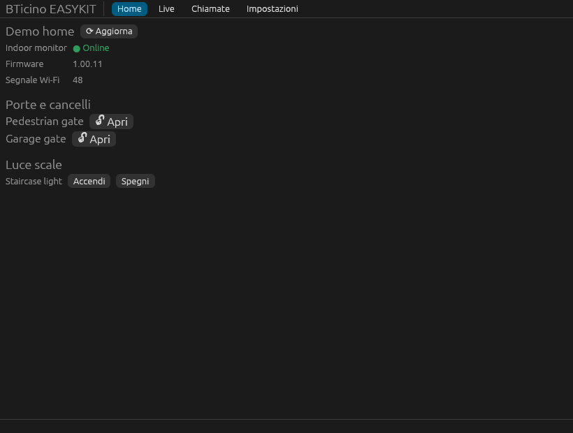
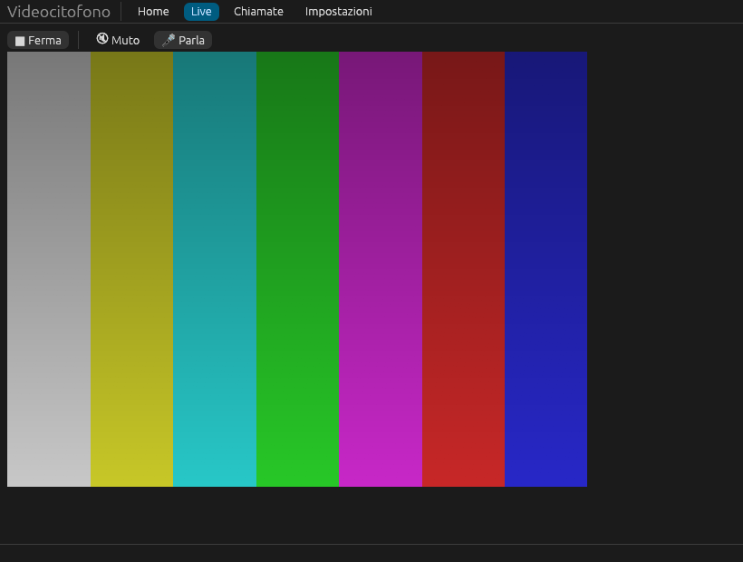
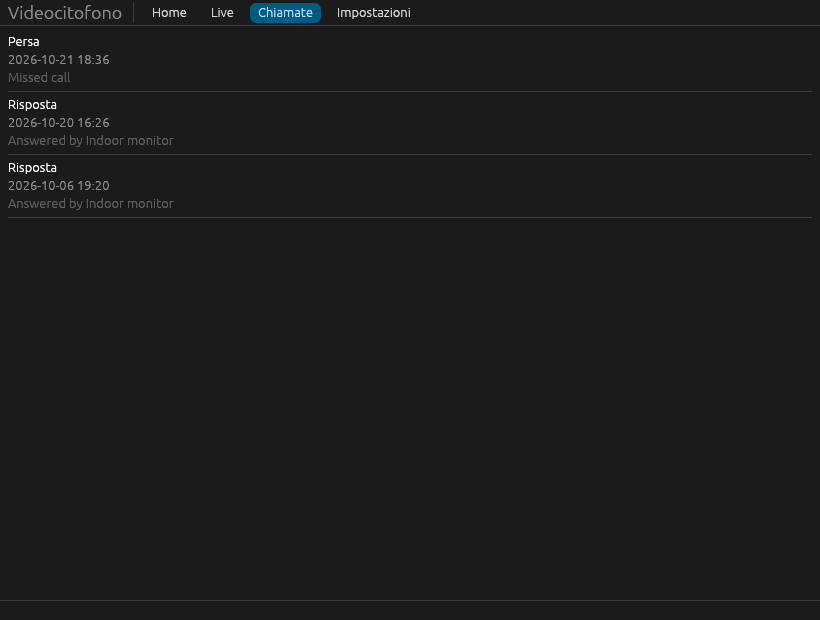

# Videocitofono per BTicino EASYKIT — Linux e Windows

[English](README.md)

App desktop e strumento a riga di comando, non ufficiali, per il videocitofono
**BTicino EASYKIT WiFi** (BTicino 310913, Legrand 360910). BTicino offre solo
l'app per telefono *Home + Security*: questo progetto porta le funzioni
principali su Linux e Windows.

> Progetto indipendente, non affiliato né approvato da BTicino, Legrand o
> Netatmo. Usa lo stesso servizio cloud dell'app ufficiale, con il tuo account
> e il tuo dispositivo. Vedi [Note legali](#note-legali).



| Visione dal vivo | Chiamate |
|---|---|
|  |  |

## Funzioni

- **Visione dal vivo** del posto esterno (video H264) con **audio
  bidirezionale**: ascolti dalle casse, con un clic apri il microfono.
- **Apertura di porta e cancello** (tutte le serrature del kit), con conferma.
- **Luce scale** accesa/spenta, comprese le luci che l'app nasconde.
- **Notifica sul desktop** quando suonano, con la foto del visitatore.
- **Storico chiamate** con miniature.
- Icona nell'area di notifica, avvio automatico, istanza unica, italiano e inglese.
- Una **CLI** per automatizzare tutto quanto sopra.

## Compatibilità

| Kit | Bridge | Stato |
|---|---|---|
| BTicino 310913 EASYKIT WiFi, firmware 1.00.11 | `BDIY` | Provato dall'autore (vedi sotto) |
| Legrand 360910 EASYKIT WiFi | `BDIY` | Stesso bridge, eventi e serrature funzionano secondo altri utenti |
| Classe 100X / 300X | `BNC1`, `BNC3`, `BNCX` | Non provati; l'API è comune, il video potrebbe richiedere modifiche |

Hai un EASYKIT? Apri una issue *Device report* con l'output di
`bticino-easykit list`.

### Cosa è verificato sull'hardware reale

| Funzione | Stato |
|---|---|
| Accesso, topologia, stato, storico chiamate | ✅ |
| Visione dal vivo: video | ✅ |
| Visione dal vivo: audio dal posto esterno (registrato e decodificato) | ✅ |
| Ascolto dalle casse, parlare dal PC | ⏳ codice pronto, non ancora provato a orecchio |
| Apertura porta (cancello pedonale e garage) | ✅ visti aprirsi |
| Notifica di squillo (WebSocket push) | ✅ |
| Rispondere a una chiamata in arrivo dal PC | ❌ non ancora (vedi *Limiti noti*) |
| Luce scale | ⏳ non provata |
| Versione Windows | compilata solo dalla CI, mai eseguita dall'autore |

## Installazione

### Arch Linux (AUR)

```sh
yay -S bticino-easykit      # compila dai sorgenti
yay -S bticino-easykit-bin  # binari precompilati
```

### Linux (archivio della release)

Scarica `bticino-easykit-vX.Y.Z-linux-x86_64.tar.gz` dalle
[release](https://github.com/deddroid/bticino-easykit/releases), poi:

```sh
tar xf bticino-easykit-*-linux-x86_64.tar.gz
cd bticino-easykit-*-linux-x86_64
./install.sh            # in ~/.local, senza root
./install.sh --uninstall
```

Non serve nessuna regola udev: il kit si raggiunge via internet, non via USB.

### Windows

Scarica lo `.zip` dalle release, estrailo e avvia `bticino-easykit-gui.exe`.
L'eseguibile non è firmato: al primo avvio SmartScreen può avvisare
(*Ulteriori informazioni → Esegui comunque*).

### Dai sorgenti

```sh
cargo build --release                        # GUI + CLI
cargo build --release --no-default-features  # solo CLI
```

Su Linux servono `alsa-lib` (`libasound2-dev`) e `pkg-config`.

## Uso

Avvia **Videocitofono per BTicino EASYKIT** dal menu e accedi con il tuo account Home + Security.
La password non viene mai salvata: solo i token di sessione, in
`~/.config/bticino-easykit/tokens.toml` (`%APPDATA%\bticino-easykit` su Windows).

La CLI:

```sh
bticino-easykit login           # chiede email e password
bticino-easykit list            # case e moduli (da allegare alle segnalazioni)
bticino-easykit status          # stato attuale (firmware, Wi-Fi, …)
bticino-easykit events          # storico chiamate
bticino-easykit live --seconds 30 --out clip   # salva video.h264 + audio.ogg
bticino-easykit listen          # stampa le notifiche di chiamata
bticino-easykit logout
```

Variabili d'ambiente:

| Variabile | Effetto |
|---|---|
| `BTICINO_EASYKIT_CONFIG_DIR` | usa un'altra cartella per token e impostazioni |
| `BTICINO_EASYKIT_DEBUG=1` | stampa il traffico grezzo con l'API (token oscurati) |
| `RUST_LOG=webrtc=debug` | dettagli interni di WebRTC |
| `BTICINO_EASYKIT_DEMO=1` | GUI con dati finti, senza rete |
| `BTICINO_EASYKIT_SCREENSHOTS=dir` | la GUI salva ogni scheda nelle due lingue ed esce |

## Limiti noti

- **Rispondere dal PC a una chiamata in arrivo non funziona ancora.** Il kit
  manda l'offerta video della chiamata solo come notifica Firebase ai telefoni
  registrati, e mentre il posto esterno squilla la visione dal vivo viene
  rifiutata ("Max number of peers reached"). La notifica di squillo arriva
  comunque e puoi aprire la porta.
- Lato dispositivo la connessione usa una chiave RSA corta e il vecchio profilo
  SRTP `AES_CM`: sono quelli che il kit supporta. L'impronta del certificato
  viene comunque verificata.
- Wayland: per andare nell'area di notifica la finestra viene chiusa e
  ricreata, perché non si può nascondere.
- Se il kit smette di mandare le chiamate al cloud, durante i test è servito
  riavviare il monitor interno.

Il funzionamento è documentato in [docs/PROTOCOL.md](docs/PROTOCOL.md) (in inglese).

## Crediti

- Autore: **deddroid** (Daniele), con **Claude** (Anthropic) come assistente di programmazione.
- [pybticino](https://github.com/k-the-hidden-hero/pybticino) e
  [bticino_intercom](https://github.com/k-the-hidden-hero/bticino_intercom)
  di k-the-hidden-hero e contributori: le basi su API, push e signaling.
- [pyatmo](https://github.com/jabesq-org/pyatmo): tipi di modulo Netatmo.
- [fcm_receiver.rs](https://github.com/agusibrahim/fcm_receiver.rs) (incluso e ridotto in `vendor/fcm_receiver`) e
  [firebase-messaging](https://github.com/sdb9696/firebase-messaging): client FCM.
- [webrtc-rs](https://github.com/webrtc-rs/webrtc), [egui](https://github.com/emilk/egui),
  [openh264](https://github.com/ralfbiedert/openh264-rs),
  [unsafe-libopus](https://github.com/DCNick3/unsafe-libopus), [cpal](https://github.com/RustAudio/cpal).
- Reverse engineering dell'app ufficiale fatto con
  [REA](https://github.com/morluto/rea), JADX e Apktool.

## Note legali

- **Marchi.** BTicino, EASYKIT, Legrand, Netatmo e Home + Security sono marchi
  dei rispettivi titolari. Qui sono usati solo per indicare con quale hardware
  funziona questo software.
- **Come è stato realizzato.** Il protocollo di rete è stato ricavato
  osservando il traffico del kit dell'autore e analizzando l'app Android
  ufficiale nei limiti necessari all'interoperabilità (Direttiva UE
  2009/24/CE, art. 6; legge 633/1941, art. 64-quater). Non è incluso codice,
  immagini o altro materiale dell'app ufficiale. Per parlare con lo stesso
  servizio cloud si usano gli identificativi OAuth e Firebase dell'app
  ufficiale; il client secret è pubblico da anni in altri progetti open source.
- **Uso a tuo rischio.** I client non ufficiali potrebbero non essere ammessi
  dai termini di servizio di Netatmo, che può cambiare o bloccare l'API cloud
  in qualsiasi momento, con possibili effetti anche sul tuo account. Questo
  software apre porte e cancelli: sei responsabile di come lo usi. Non è
  fornita alcuna garanzia (vedi la licenza).
- **Privacy.** La password non viene mai salvata; i token restano sul tuo
  computer. I log di debug nascondono token, posizione e link alle immagini.
- Licenze di terze parti dei crate inclusi: [THIRD-PARTY-LICENSES.md](THIRD-PARTY-LICENSES.md).

## Licenza

[MIT](LICENSE)
