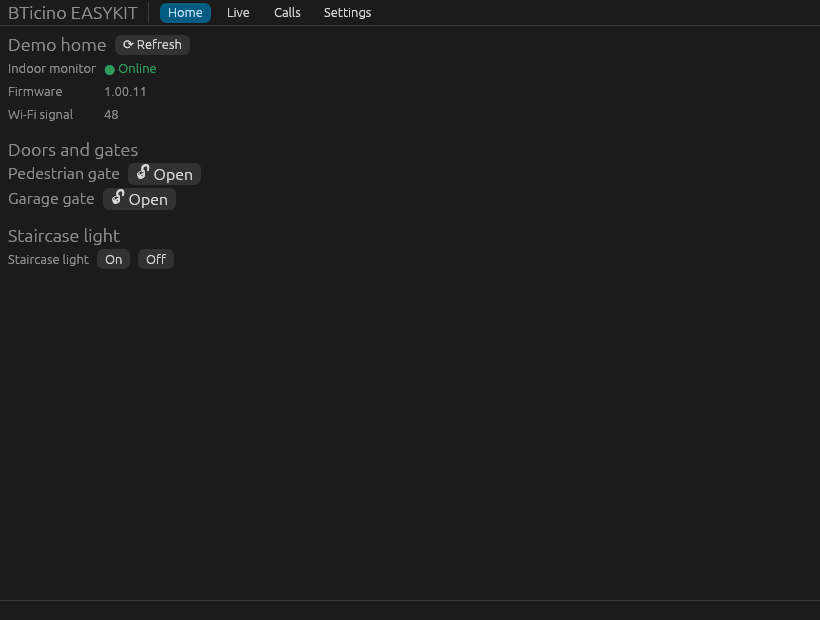
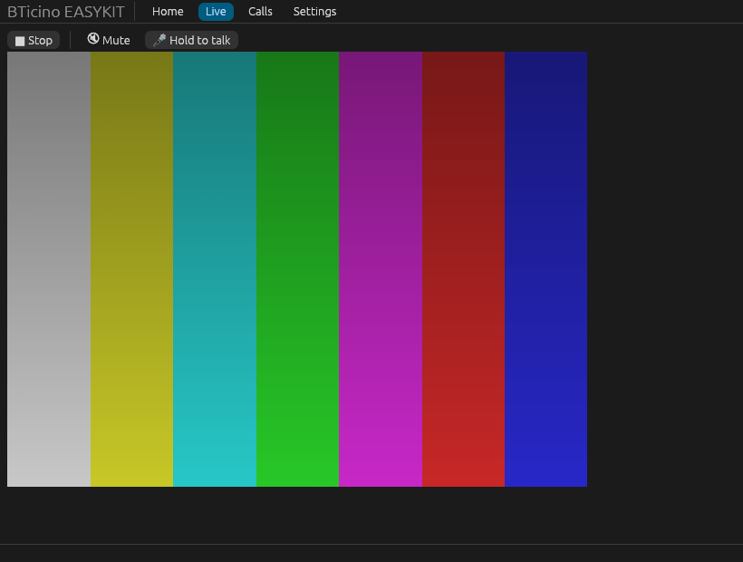
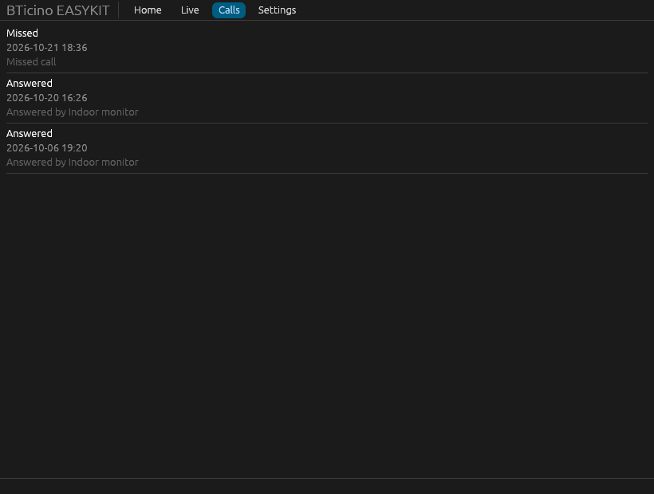

# BTicino EASYKIT for Linux and Windows

[Italiano](README.it.md)

Unofficial desktop app and command-line tool for the **BTicino EASYKIT WiFi**
video door entry kit (BTicino 310913, Legrand 360910). BTicino only offers the
*Home + Security* phone app; this project brings the main features to Linux and
Windows.

> Not affiliated with BTicino, Legrand or Netatmo. It talks to the same cloud
> service as the official app, with your own account.



| Live view | Calls |
|---|---|
|  |  |

## Features

- **Live view** of the entrance panel (H264 video) with **two-way audio**:
  listen through the speakers, hold a button to talk.
- **Open the door and the gate** (every lock of the kit), with a confirmation.
- **Staircase light** on/off, including lights the phone app hides.
- **Ring notifications** on the desktop with the visitor's snapshot.
- **Call history** with thumbnails.
- Tray icon, start with the system, single instance, English and Italian.
- A scriptable **CLI** for everything above.

## Compatibility

| Kit | Bridge | Status |
|---|---|---|
| BTicino 310913 EASYKIT WiFi, firmware 1.00.11 | `BDIY` | Tested by the author (see below) |
| Legrand 360910 EASYKIT WiFi | `BDIY` | Same bridge, reported working by others for events and locks |
| Classe 100X / 300X | `BNC1`, `BNC3`, `BNCX` | Not tested; the API is shared, live view may need changes |

Other EASYKIT owners: please open a *Device report* issue with the output of
`bticino-easykit list`.

### What is verified on real hardware

| Feature | Status |
|---|---|
| Sign-in, topology, status, call history | ✅ |
| Live view: video | ✅ |
| Live view: audio from the panel (recorded and decoded) | ✅ |
| Hearing it on the speakers, talking from the PC | ⏳ code ready, not yet checked by ear |
| Door release (pedestrian and garage gate) | ✅ seen opening |
| Ring notification (push WebSocket) | ✅ |
| Answering an incoming call from the PC | ❌ not yet (see *Known limitations*) |
| Staircase light | ⏳ not tested |
| Windows build | built by CI only, never run by the author |

## Install

### Arch Linux (AUR)

```sh
yay -S bticino-easykit      # builds from source
yay -S bticino-easykit-bin  # prebuilt binaries
```

### Linux (release archive)

Download `bticino-easykit-vX.Y.Z-linux-x86_64.tar.gz` from the
[releases](https://github.com/deddroid/bticino-easykit/releases), then:

```sh
tar xf bticino-easykit-*-linux-x86_64.tar.gz
cd bticino-easykit-*-linux-x86_64
./install.sh            # into ~/.local, no root
./install.sh --uninstall
```

No udev rule is needed: the kit is reached through the internet, not USB.

### Windows

Download the `.zip` from the releases, extract it and run
`bticino-easykit-gui.exe`. The executable is not signed, so SmartScreen may
warn on first start (*More info → Run anyway*).

### From source

```sh
cargo build --release                        # GUI + CLI
cargo build --release --no-default-features  # CLI only
```

Linux needs `alsa-lib` (`libasound2-dev`), `openssl` and `pkg-config`.

## Usage

Start **BTicino EASYKIT** from the menu and sign in with your Home + Security
account. The password is never stored: only the session tokens, in
`~/.config/bticino-easykit/tokens.toml` (`%APPDATA%\bticino-easykit` on Windows).

The CLI:

```sh
bticino-easykit login           # asks email and password
bticino-easykit list            # homes and modules (use this for bug reports)
bticino-easykit status          # live status (firmware, Wi-Fi, …)
bticino-easykit events          # call history
bticino-easykit live --seconds 30 --out clip   # save video.h264 + audio.ogg
bticino-easykit listen          # print call notifications as they arrive
bticino-easykit logout
```

Environment variables:

| Variable | Effect |
|---|---|
| `BTICINO_EASYKIT_CONFIG_DIR` | use another directory for tokens and settings |
| `BTICINO_EASYKIT_DEBUG=1` | print the raw API traffic (tokens redacted) |
| `RUST_LOG=webrtc=debug` | WebRTC internals |
| `BTICINO_EASYKIT_DEMO=1` | GUI with fake data, no network |
| `BTICINO_EASYKIT_SCREENSHOTS=dir` | GUI saves every tab in both languages and exits |

## Known limitations

- **Answering an incoming call from the PC does not work yet.** The kit sends
  the call's video offer only as a Firebase push to registered phones; the
  live view cannot be opened while the panel is ringing ("Max number of peers
  reached"). You still get the ring notification and can open the door.
- The connection uses a short RSA key on the device side and the older
  `AES_CM` SRTP profile: both are what the kit supports. The certificate
  fingerprint is still checked.
- Wayland: the window is closed and re-created to go to the tray, since it
  cannot be hidden.
- If the kit stops reporting calls to the cloud, restarting the indoor monitor
  helped in testing.

How everything works is documented in [docs/PROTOCOL.md](docs/PROTOCOL.md).

## Credits

- Author: **deddroid** (Daniele), with **Claude** (Anthropic) as coding assistant.
- [pybticino](https://github.com/k-the-hidden-hero/pybticino) and
  [bticino_intercom](https://github.com/k-the-hidden-hero/bticino_intercom)
  by k-the-hidden-hero and contributors: API, push and signaling groundwork.
- [pyatmo](https://github.com/jabesq-org/pyatmo): Netatmo module types.
- [fcm_receiver.rs](https://github.com/agusibrahim/fcm_receiver.rs) and
  [firebase-messaging](https://github.com/sdb9696/firebase-messaging): FCM client.
- [webrtc-rs](https://github.com/webrtc-rs/webrtc), [egui](https://github.com/emilk/egui),
  [openh264](https://github.com/ralfbiedert/openh264-rs),
  [unsafe-libopus](https://github.com/DCNick3/unsafe-libopus), [cpal](https://github.com/RustAudio/cpal).
- Reverse engineering of the official app done with
  [REA](https://github.com/morluto/rea), JADX and Apktool.

## License

[MIT](LICENSE)
